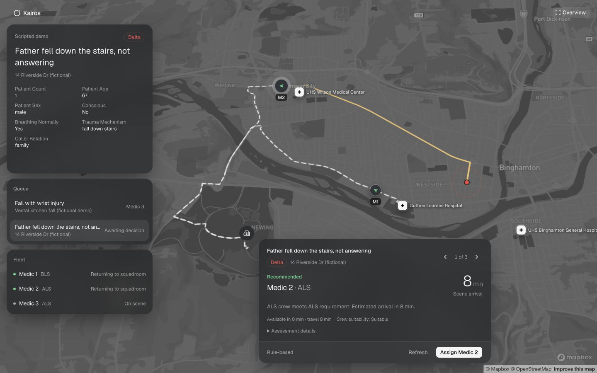

# Kairos

**AI-assisted ambulance dispatch.** Kairos combines ElevenLabs phone intake, a live fleet dashboard, and Qwen-4b-Dispatch, our fine-tuned 4B model. Dispatchers compare incident assessments, crew capabilities, and estimated arrival times before approving or overriding a recommendation.

Built for NYCAIRR × HackBU 2026 using Empire AI compute. The fleet and assignments are simulated; this is a hackathon prototype, not an operational emergency dispatch service.



*Prototype screenshot captured in local rule-based demo mode; it does not demonstrate Qwen inference.*

## Model training and results

We fine-tuned `Qwen/Qwen3-4B-Instruct-2507` using QLoRA on a **10 GB H100 MIG slice**. The training stack is PyTorch, Transformers, TRL, PEFT, and bitsandbytes: 4-bit NF4 base weights, BF16 computation, rank-16 adapters, gradient checkpointing, and effective batch size 16. Initial training used 3,000 synthetic scenarios; the selected follow-up adapter used 3,940.

| Model / pipeline | Acuity · 300 cases | Ambulance selection · 264 eligible cases |
|---|---:|---:|
| Base Qwen3-4B | 71.3% | 81.1% |
| GPT-5.4-mini | 85.7% | 88.6% |
| GPT-6 Luna | 88.0% | 90.2% |
| Qwen-4b-Dispatch | 91.7% | 94.3% |
| **Qwen-4b-Dispatch + deterministic guardrails** | **92.0%** | **99.2%** |

Raw models received the same scenarios and full rubric prompt with structured output; GPT runs disabled reasoning. The combined pipeline was measured in a separate inference run. Guardrails do not change acuity. These are synthetic rubric scores, not clinical validation; development used evaluation feedback. See [benchmark methodology and evidence](docs/benchmarks.md).

## How it works

1. ElevenLabs collects incident details over a phone conversation and sends structured updates to the backend.
2. Once intake is complete, the backend supplies incident facts and candidate fleet context to Qwen.
3. Qwen predicts acuity, explains its assessment, summarizes the incident, and proposes a unit.
4. The configured deterministic guardrail layer recomputes fleet suitability, ranking, and candidate reasons using Qwen’s acuity. It may replace the model’s proposed ambulance.
5. The dispatcher reviews the recommendation and approves or overrides it. Accepted assignments are protected from late model responses.

The guardrail implements our explicit prototype fleet rubric, including capability requirements and an arrival-time/crew-experience exception. It does not validate the clinical correctness of Qwen’s assessment. The separate local fallback can produce a complete rule-based assessment if inference is unavailable.

## Run locally

Install Node.js compatible with Next.js 16 and use the pinned pnpm version. From the repository root:

```bash
cd web
npm exec --yes --package=pnpm@10.34.9 -- pnpm install --frozen-lockfile
cp .env.example .env.local
npm run dev
```

Copy the environment template only on first setup; preserve an existing `.env.local`. Set Mapbox tokens for mapping/routing and a private `VOICE_TOOL_SECRET` for ElevenLabs tools. Open `http://localhost:3000`. The default `MODEL_MODE=mock` runs the local rubric without a model server. Use **⌘D / Ctrl+D** to open staged fleet demos.

For Qwen inference, configure:

```dotenv
MODEL_MODE=model
MODEL_PROVIDER=compatible
MODEL_BASE_URL=http://127.0.0.1:8000/v1
MODEL_NAME=qwen3-4b-dispatch-lora
MODEL_RESPONSE_FORMAT=json_schema
```

The trained adapter and cluster access are separate requirements; selecting a model name does not download or train it. Follow [serving instructions](model/SERVING.md), including `SERVE_RANK_CANDIDATES=1` for the guardrail pipeline. Keep keys in local environment files. The app uses one long-lived Node process with in-memory state, disk snapshots, and server-sent events.

## Repository

| Path | Contents |
|---|---|
| [web/](web/README.md) | Next.js dashboard, APIs, state, routing, and simulated fleet |
| [model/](model/README.md) | Synthetic data, training, evaluation, serving, and schemas |
| [docs/architecture.md](docs/architecture.md) | Intake flow, state consistency, and guardrails |
| [docs/training.md](docs/training.md) | Training configuration, data, and experiment history |
| [docs/benchmarks.md](docs/benchmarks.md) | Results, denominators, evidence, and limitations |
| [submission/DEVPOST.md](submission/DEVPOST.md) | Full Devpost submission draft |
| [submission/assets/](submission/assets/) | Desktop gallery screenshots and earlier provisional chart |

## Development checks

From `web/`:

```bash
npm run contracts:check
npm run recommendations:check
npm run simulation:check
npm run demo:check
npm run dispatch:check
npm run typecheck
npm run lint
npm run build
```

See [web documentation](web/README.md) for the isolated HTTP integration check. Model evaluation commands and requirements are in [model documentation](model/README.md).
